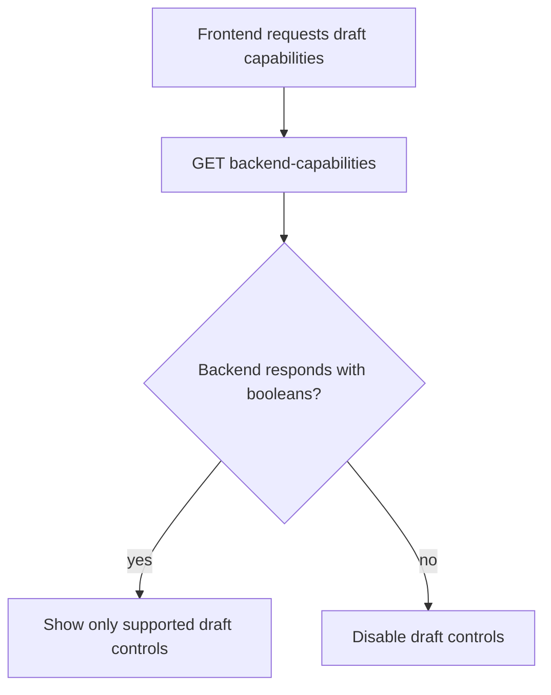

# Draft capability discovery

The frontend and backend can deploy independently. This endpoint reports only
whether the deployed backend has the routes required by the draft panels.
Browser QA is planned; the backend route and frontend fallback have unit tests.

`/openapi.json` remains available only in DEBUG mode. The capability response
contains no tenant data or full API schema, and both sides send `Cache-Control:
no-store` so deployment changes become visible on the next request.
